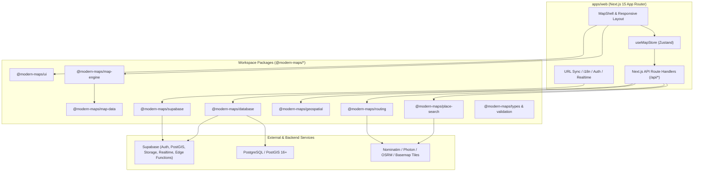

# System Architecture

This document describes the technical architecture of the **Modern Maps & Location Intelligence Platform**, a pnpm + Turborepo monorepo built with Next.js 15, React 19, MapLibre GL 5, Drizzle ORM, PostGIS, and Supabase.

---

## High-Level Architecture

---

## 1. Frontend Application (`apps/web`)

The web application (`apps/web/src/`) is a Next.js 15 App Router application using React 19, Tailwind CSS, and Zustand.

### Layout & Map Shell
- **`MapShell`** (`apps/web/src/components/MapShell.tsx`): Root client shell that renders:
  - `DynamicInteractiveMap` (client-only dynamic import of `InteractiveMap` with `ssr: false` for WebGL/MapLibre GL).
  - `TopNavBar`: Floating top navigation with search bar, language switcher, theme toggle, auth status, and layer selector toggle.
  - `FloatingMapCards`: Desktop/tablet floating sidebar cards (`ResizableSidebar`, `SearchPanel`, `DirectionsView`, `PlaceDetailsView`, `SavedPlacesView`).
  - `MobileBottomSheet`: Responsive mobile bottom sheet for search, directions, and place details.
  - `useUrlSync`: Two-way URL synchronization (`?lat=...&lng=...&z=...&pitch=...&bearing=...`).

### State Management (`useMapStore`)
- Defined in `apps/web/src/stores/useMapStore.ts` using Zustand.
- Manages:
  - **Camera & Style**: `camera` (`center`, `zoom`, `pitch`, `bearing`) and `activeStyle` (default `'satellite'`).
  - **Sidebar & Navigation**: `sidebarOpen`, `sidebarWidth` (clamped between `280` and `600` px), `sidebarView` (`'search' | 'directions' | 'place' | 'saved'`).
  - **Search & Places**: `searchQuery`, `selectedCategory`, `selectedPlace`, `liveSearchResults`, `isSearching`, `executeSearch`, `savedPlaces`, `toggleSavePlace`, `isPlaceSaved`.
  - **Directions**: `directions` (`origin`, `destination`, `mode`, `routeGeometry`, `steps`, `distanceMeters`, `durationSeconds`).

### Internationalization (`features/i18n`)
- Supports 6 locales (`apps/web/src/features/i18n/types.ts` and `locales/*.json`):
  - `en` (English)
  - `vi` (Vietnamese)
  - `ko` (Korean)
  - `ja` (Japanese)
  - `zh-CN` (Simplified Chinese)
  - `zh-TW` (Traditional Chinese)

### Authentication & Realtime (`features/auth`, `features/realtime`)
- **SSR Auth**: Uses `@supabase/ssr` via `apps/web/src/lib/supabase/client.ts`, `server.ts`, `middleware.ts`, and `/auth/callback/route.ts`.
- **Realtime Hooks**: `usePresence`, `useRealtimeFeatures`, and `useLiveLocation` for collaborative mapping sessions and live feature synchronization.

---

## 2. Map Rendering Engine (`@modern-maps/map-engine`)

- **`MapLibreRenderer`** (`packages/map-engine/src/renderer/MapLibreRenderer.ts`): Wraps MapLibre GL JS (`^5.1.0`) with camera controls (`getCameraState`, `setCameraState`, `easeTo`, `jumpTo`, `resetNorth`, `toggle3D`), style management, and lifecycle helpers.
- **`MapContainer`** (`packages/map-engine/src/react/MapContainer.tsx`): React wrapper with error boundary (`MapErrorBoundary`) and context (`MapContext`).
- **`LayerManager`** (`packages/map-engine/src/layers/LayerManager.ts`): Manages vector/raster sources, layers, and markers.
- **Measurement & Drawing**: Built-in tools under `packages/map-engine/src/measure/` and `packages/map-engine/src/drawing/`.

---

## 3. Data, Search & Routing Services

### Place Search & Geocoding (`@modern-maps/place-search`)
- **`PlaceSearchService`** (`packages/place-search/src/search-service.ts`):
  - Uses `NominatimProvider` as the default primary search, autocomplete, and reverse-geocoding provider, with `PhotonProvider` available as an alternative/fallback.
  - Includes an in-memory `SearchCache` (5-minute TTL for forward search/autocomplete, 15-minute TTL for reverse geocoding by default).
  - Supports category filtering, proximity bias, and bounding-box constraints.

### Routing (`@modern-maps/routing`)
- **`RoutingService`** (`packages/routing/src/routing-service.ts`):
  - Primary provider: `OsrmRoutingProvider` (Open Source Routing Machine).
  - Automatic fallback: `MockRoutingProvider` when OSRM fails or returns no routes.
  - In-memory response cache with a 15-minute TTL keyed by mode, coordinates, and `alternatives`.

---

## 4. Database & Persistence (`@modern-maps/database`)

`createDatabaseClient()` / `getDatabase()` (`packages/database/src/client.ts`) resolves the database adapter in the following order:

1. **`PostgresDatabaseAdapter`**: Used when `DATABASE_URL` is configured and is not a placeholder string (uses `postgres` + Drizzle ORM).
2. **`SupabaseDatabaseAdapter`**: Used as fallback when `NEXT_PUBLIC_SUPABASE_URL` (or `SUPABASE_URL`) and `SUPABASE_SERVICE_ROLE_KEY` (or `NEXT_PUBLIC_SUPABASE_ANON_KEY`) are configured.
3. **`InMemoryDatabaseAdapter`**: Used when neither Postgres nor Supabase is configured (or when `forceMemory: true`), enabling offline development and isolated Vitest runs.

### PostGIS Schema & Spatial Capabilities
Migrations live in `supabase/migrations/` and cover:
- Extensions: `postgis`, `pgcrypto`, `uuid-ossp`.
- Tables: `user_profiles`, `user_preferences`, `saved_places`, `place_collections`, `collection_items`, `search_history`, `user_map_features`, `shared_collections`, `map_layer_preferences`, `location_shares`.
- Spatial GiST indexes and PostGIS RPCs (`nearby_saved_places`, `features_in_viewport`, etc.).
- Row-Level Security (RLS) policies on all tables, 4 Storage buckets (`place-photos`, `collection-covers`, `geojson-imports`, `map-attachments`), and Supabase Realtime publications.
